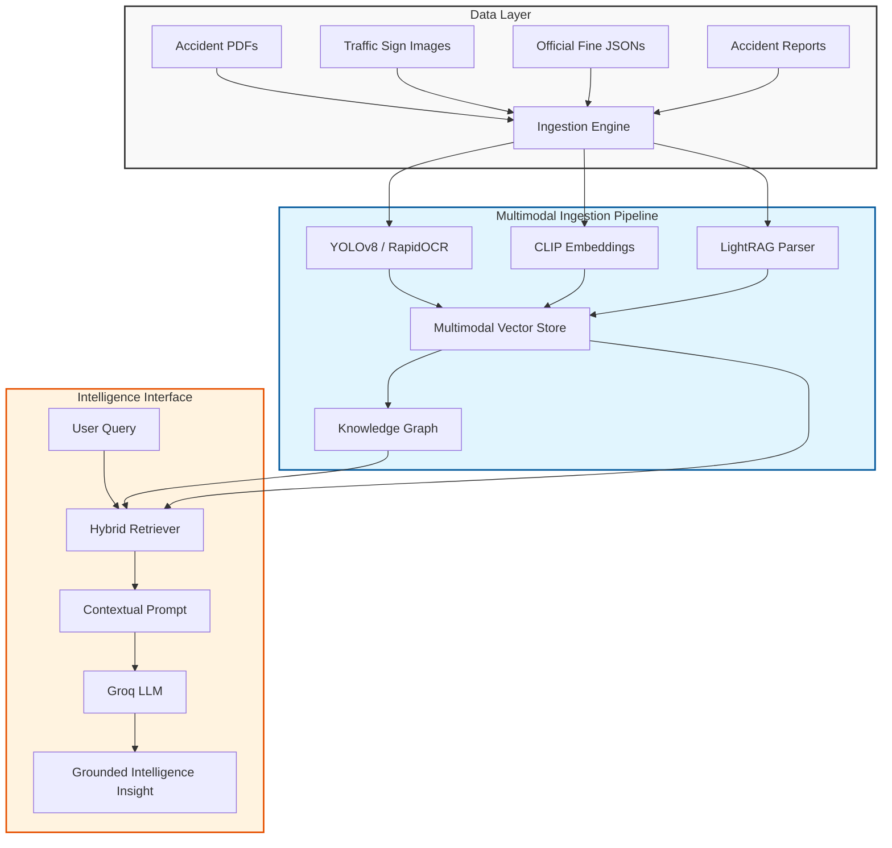
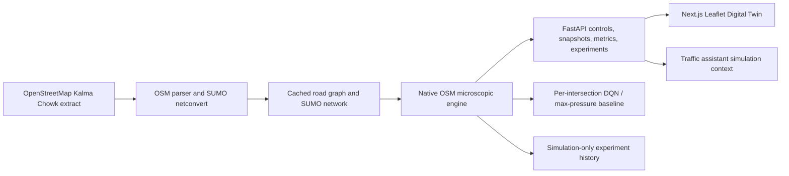

<div align="center">


<a href="https://git.io/typing-svg">
  
</a>

<br/>

[](https://www.python.org/)
[](https://fastapi.tiangolo.com/)
[](https://nextjs.org/)
[](https://groq.com/)
[](https://ultralytics.com/)
[](https://www.typescriptlang.org/)

<br/>

**A production-grade AI system bridging the gap between raw traffic sensor data, accident reports, and actionable urban intelligence.**

<br/>

<a href="#-system-architecture">
  
</a>
<a href="#-installation-and-setup">
  
</a>
<a href="#-core-features">
  
</a>

</div>

---

## 📌 Overview

**Lahore Traffic Intelligence AI** is a sophisticated multimodal Retrieval-Augmented Generation (RAG) system designed to analyze, synthesize, and query complex urban traffic datasets. Unlike traditional text-based RAG, this system implements a **Vision-Language pipeline** that integrates Computer Vision (YOLOv8), semantic image embeddings (CLIP), and structured Knowledge Graphs to provide grounded insights into traffic patterns and incident reporting.

The system transforms unstructured data—including accident PDFs, traffic sign imagery, and official penalty schedules—into a searchable, high-fidelity knowledge base.

## ✨ Core Features

### 👁️ Multimodal Perception Pipeline
- **Object Detection**: Integration of **YOLOv8** for high-precision detection of vehicles, motorcycles, and riders.
- **Specialized Vision Modules**: Dedicated detectors for **Helmet Compliance** and **License Plate Localization**.
- **OCR Intelligence**: Integration of **RapidOCR (PP-OCRv4)** for extracting text from license plates and traffic signage.
- **Semantic Image Search**: CLIP-based embeddings allowing users to retrieve visually similar accident evidence via natural language.

### 🧠 Intelligence Engine
- **Hybrid RAG-Anything**: A dual-retrieval strategy combining **Naive Vector Search** (semantic chunks) with **Graph-based Retrieval** (relational entities).
- **Knowledge Graph Integration**: Automatic extraction of entities and relationships, exportable via **GraphML** for structural analysis in tools like Gephi.
- **Groq-Accelerated Inference**: Leveraging LPU technology for ultra-low latency LLM responses, ensuring real-time query performance.
- **Strict Grounding**: A rigorous evidence-boundary system that prevents model hallucination by strictly adhering to sourced accident reports and official regulations.

### 🛠️ Evidence & Legal Pipeline
- **Violation Analysis**: Deterministic rules engine that maps visual detections (e.g., "no helmet") to official Punjab traffic fines.
- **Automated Report Generation**: Synthesis of visual evidence, detected violations, and legal citations into a professional report format.
- **Provenance Tracking**: Every insight is linked back to a specific source ID, page number, or image URL.

---

## 🧱 System Architecture



---

## 🚀 Technology Stack

| Layer | Technology | Purpose |
| :--- | :--- | :--- |
| **Frontend** | `Next.js 16`, `React 19`, `Tailwind CSS 4` | High-performance, motion-enhanced monitoring dashboard |
| **Backend** | `FastAPI`, `Pydantic` | Asynchronous API orchestration and state management |
| **RAG Framework** | `RAG-Anything`, `LightRAG` | Multimodal retrieval and Graph-based knowledge management |
| **LLM Engine** | `Groq` (LPU) | Ultra-fast inference for grounded text generation |
| **Vision** | `YOLOv8`, `ONNX Runtime` | Real-time object detection and violation analysis |
| **OCR** | `RapidOCR` | Text extraction from plates and signage |
| **Embeddings** | `Sentence-Transformers` | Local semantic vectorization (`all-MiniLM-L6-v2`) |
| **Storage** | `SQLite`, `NumPy (.npz)` | Conversation history and image embedding storage |

---

## 🔧 Installation and Setup

### 📋 Prerequisites
- **Python**: $\ge 3.12, < 3.14$
- **Node.js**: $\ge 18.0.0$
- **Hardware**: GPU recommended for YOLOv8 inference (CPU fallback supported via ONNX)

### 🛠️ Backend Setup
```bash
# Navigate to backend
cd backend

# Create and activate virtual environment
python -m venv venv
# Windows:
venv\Scripts\activate
# macOS/Linux:
source venv/bin/activate

# Install dependencies
pip install -r pyproject.toml
```

**Environment Configuration**
Create a `.env` file in the `backend/` directory:
```env
GROQ_API_KEY=your_groq_api_key_here
RAG_ENABLED=True
RAG_QUERY_MODE=hybrid
BACKEND_CORS_ORIGINS=http://localhost:3000
```

### 💻 Frontend Setup
```bash
# Navigate to frontend
cd frontend

# Install dependencies
npm install

# Start development server
npm run dev
```

---

## 📖 Usage Examples

### 1. Incident Intelligence Query
**User**: *"What are the common causes of accidents in the Gulberg area of Lahore?"*  
**System**: Retrieves accident reports from the vector store $\to$ Extracts patterns from the Knowledge Graph $\to$ Synthesizes a response grounded in official reports.

### 2. Visual Evidence Analysis
**User**: (Uploads image of a motorcycle rider)  
**System**: 
1. **Detection**: Identifies `motorcycle` and `person`.
2. **Analysis**: Checks for `helmet` $\to$ Result: `Negative`.
3. **Legal Mapping**: Maps "No Helmet" to `Punjab Traffic Fine Schedule` $\to$ Identifies PKR amount.
4. **Output**: Generates a report with visual crops as evidence.

---

## Lahore Traffic Digital Twin

The Digital Twin is available from the **Digital Twin** section of the existing Next.js application. It uses a cached OpenStreetMap extract around Kalma Chowk and stores simulation experiments in the existing SQLite database. Simulation observations are kept separate from reported road incidents.

### Architecture and current engine status



The current live dashboard engine is explicitly reported as **Native OSM microsimulation**. SUMO 1.27.1, `netconvert`, and TraCI are supported and the generated network is validated by SUMO; a TraCI smoke run successfully inserted and moved a vehicle. The dashboard's lifecycle and live snapshots still use the project's native microscopic engine. This distinction avoids presenting SUMO availability as proof that the live dashboard is currently driven by TraCI.

The native engine models cars, motorcycles, buses, and a generic other vehicle class with configurable headway, acceleration, deceleration, and speed. Its traffic demand and peak mix are scenario parameters, not measured Lahore counts. Signal agents use fixed-time or max-pressure control until a DQN checkpoint is trained. DQN training uses per-junction queue, waiting-time, occupancy, phase, elapsed-time, and neighboring-pressure observations; exploratory actions are safety-interlocked by minimum/maximum green and yellow clearance. Its reward penalizes incremental waiting, queues, signal switches, and new simulated collisions, and rewards throughput. A newly trained checkpoint is not evidence of improved performance: use paired comparisons with the same seed and inspect measured results.

### Windows setup and operation

From PowerShell at the repository root:

```powershell
cd backend
uv sync
uv run python scripts/import_lahore_network.py
uv run uvicorn app.main:app --reload --host 127.0.0.1 --port 8000
```

In a second PowerShell window:

```powershell
cd frontend
npm install
npm run dev
```

Open `http://localhost:3000` and choose **Digital Twin**. SUMO is detected through `SUMO_HOME`, `backend` settings, `tools/sumo`, common Windows install folders, or `PATH`. The import command reuses the cached extract; pass `--force-download` to refresh it. If SUMO is not installed, install a compatible Eclipse SUMO Windows release and set `SUMO_HOME` to its installation directory before running the import command. The import script fails explicitly if SUMO or `netconvert` is missing and runs SUMO against the generated network to validate it.

Run backend checks with `uv run pytest -q` from `backend`; run the frontend production build with `npm run build` from `frontend`.

The simulation API is mounted under `/api/v1/simulation`: `/status`, `/network`, `/snapshot`, `/metrics`, `/control`, `/config`, `/scenarios`, `/experiment/scenario`, `/experiment/compare`, `/experiments`, `/training/start`, `/training/status`, `/risks`, `/context`, and `/ws`. The chat assistant includes live simulation context for simulation-intelligence questions and can add retrieved traffic evidence. Simulation findings are labeled as simulated; they are not real-world traffic observations or crash reports.

Experiments compare fixed-time control with a trained RL model when present, otherwise with the max-pressure AI baseline. Results include the actual treatment controller and are persisted with the scenario, demand, duration, seed, metrics, and comparison. Scenarios include peak and motorcycle-heavy demand, road closure, blocked lane, capacity reduction, demand increase, signal failure, and longer fixed greens. Risk indicators are experimental kinematic measures (following TTC and braking) and simulated collisions; they are not crash predictions or reported accidents.

### Network data and licensing

The extract is requested from the OpenStreetMap API for a bounded box around Kalma Chowk (approximately 31.4990–31.5080 N, 74.3260–74.3370 E), cached under `data/simulation/kalma_chowk/`, and converted to SUMO plain XML with `netconvert`. Data contributors are credited by OpenStreetMap under the [Open Database License (ODbL)](https://www.openstreetmap.org/copyright). Road names, lane counts, speeds, and signal tags can be incomplete; parser defaults are estimates where tags are absent. No downloaded map layout is invented. If network acquisition is unavailable at first run, the application falls back to a labeled synthetic four-arm demonstration network, which is not a real Kalma Chowk layout.

### Limitations

- The current live UI uses the native OSM engine; SUMO network conversion and standalone TraCI operation are verified, but live manager integration with TraCI remains unfinished.
- Demand profiles are scenario inputs and are not calibrated to field counts. Simulation results do not establish real-world signal effectiveness.
- The DQN is a small CPU-compatible research implementation, not a pretrained or field-validated controller. Training is reproducible and resumable, but performance must be demonstrated by recorded paired runs.
- Collision-risk thresholds are kinematic indicators with simplified following behavior. They must not be interpreted as actual accidents or validated safety predictions.
- OSM geometry is licensed ODbL and remains subject to contributor attribution and share-alike terms.


## 📁 Project Directory Structure

```text
Lahore-Traffic-AI/
├── backend/               # FastAPI Core
│   ├── app/
│   │   ├── api/           # REST Endpoints
│   │   ├── core/          # Global Config & Settings
│   │   ├── ingestion/     # Multimodal Data Pipeline
│   │   ├── rag/           # RAG-Anything / LightRAG Engine
│   │   └── services/      # Vision, Evidence, & Database Logic
│   ├── models/            # YOLOv8 & OCR Weights
│   └── rag_storage/       # Vector & Graph Indices
├── frontend/              # Next.js 16 Dashboard
│   ├── app/               # App Router & Pages
│   └── components/        # UI Components (Tailwind/Motion)
├── scripts/               # Data Acquisition & Eval Tools
├── data/                  # Raw & Processed Datasets
└── graphs/                # Canonical source-traceable graph corpus and visualization
    └── knowledge_graph/   # XML corpus and PNG graph image
```

### Knowledge graph corpus

The canonical project graph is in [`graphs/knowledge_graph/`](graphs/knowledge_graph/). It is generated from the project’s structured traffic data, normalized accident records, OpenStreetMap simulation network, persisted RAG chunks, PDF page text, the migrated legacy LightRAG snapshot, and the current LightRAG graph.

The corpus follows RAG-Anything’s broad ideas of representing entities and relationships with source provenance and retaining multimodal references. The PNG is generated from the XML and summarizes the full corpus by entity type so the connections remain readable; the XML retains the individual records. The exact entity, relationship and chunk counts are written into the XML `<metadata>` block and into the ingestion manifest, so the artefacts always state what was actually persisted.

Regenerate the XML and its single PNG graph image from the repository root. XML validation uses the schema at `scripts/knowledge_graph.xsd`:

```powershell
backend/.venv/Scripts/python.exe scripts/build_knowledge_graph.py
```

The build is local and deterministic with respect to source data. It makes no model or network calls. The `graphs/knowledge_graph/` directory contains only `knowledge_graph.xml` and `knowledge_graph_visualization.png`.

### PDF ingestion

The four traffic PDFs are parsed and indexed into LightRAG by:

```powershell
backend/.venv/Scripts/python.exe scripts/ingest_rag_documents.py
```

The run checksums `backend/rag_storage/`, restores it if the run cannot finish, and writes every per-document outcome to `data/processed/metadata/rag_document_ingestion.json`. A document counts as ingested only when LightRAG’s own `doc_status` records it as processed — `process_document_complete` returns normally even when extraction fails, so its return value is never treated as proof.

Three environment problems used to make this impossible, and each is now handled explicitly:

- **Parser.** RAG-Anything 1.4.1 invokes MinerU through the legacy `mineru -p <pdf> -o <dir>` command line. MinerU 4.x ships a different, subcommand-based CLI that rejects those flags and needs a separately started local server, so every parse failed with exit code 2. `backend/app/rag/pdf_parser.py` implements the same content-list contract on PyMuPDF — layout-aware text, ruled tables, in-flow figures — and OCRs image-only pages with the bundled offline RapidOCR models. That recovers real content from the scanned NHMP sign handbook, whose 44 pages previously yielded 770 characters in total. The engine probes the MinerU CLI once and falls back automatically, recording the reason in the manifest. Set `RAG_PARSER=pymupdf` to skip the probe.
- **Extraction model.** Groq’s `openai/gpt-oss` models return reasoning in a `reasoning` field that LightRAG never reads, so a completion spent entirely on reasoning arrived as empty content. The engine pins `reasoning_effort=low` and retries.
- **Provider limits.** This Groq organization is capped at 8,000 tokens per minute, and an uncapped completion allowance counts against that budget, so large extraction requests were rejected with HTTP 413 before any output. `RAG_LLM_MAX_COMPLETION_TOKENS` and `RAG_CHUNK_TOKEN_SIZE` bound every request to fit the ceiling, and `RAG_LLM_MAX_ASYNC` keeps extraction sequential. The configured `GROQ_VISION_MODEL` is decommissioned and this account has no vision-capable model at all, so figures are indexed from their source caption only — no visual analysis is invented, and figure entities are named after their source file rather than mislabelled as verified photographs.

---

## ⚠️ Technical Limitations & Considerations

<details>
<summary><b>Click to view Model Constraints</b></summary>

- **Temporal Data**: Single images do not establish movement; findings are static and require manual review for behavioral violations.
- **Class Granularity**: The current COCO-based weights do not reliably distinguish between vans and rickshaws.
- **OCR Accuracy**: Plate text is unverified and must be cross-checked against the provided image crop.
- **Context**: Punjab fine amounts are based on the most recently available structured registry; local jurisdictional variations may exist.
</details>

---

## 🤝 Contributing

Contributions to improve the **Vision-RAG** accuracy or expand the **Knowledge Graph** depth are welcome.

1. Fork the Project
2. Create your Feature Branch (`git checkout -b feature/AmazingFeature`)
3. Commit your Changes (`git commit -m 'feat: Add some AmazingFeature'`)
4. Push to the Branch (`git push origin feature/AmazingFeature`)
5. Open a Pull Request

---

## 📄 License

This project is open-source and provided "as-is" for research and public safety enhancement.

<div align="center">

### Built with obsession by **Salik Ahmad** 🤖

<p>
  <a href="https://salikahmad.vercel.app/" target="_blank">
    
  </a>
  <a href="https://www.linkedin.com/in/salik-ahmad-programmer/" target="_blank">
    
  </a>
  <a href="https://github.com/SalikAhmad702" target="_blank">
    
  </a>
</p>

<br/>

<a href="https://salikahmad.vercel.app/">
  
</a>

<br/>


</div>
