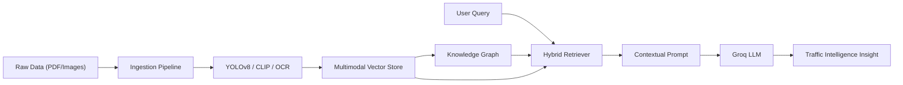

<div align="center">


<a href="https://git.io/typing-svg">
  
</a>

<br/>

<p>
  
  
  
  
  
  
</p>

</div>

<br/>

## 📌 Overview

**Lahore Traffic Intelligence AI** is a sophisticated multimodal RAG (Retrieval-Augmented Generation) system designed to analyze and synthesize traffic data, accident reports, and visual evidence. Unlike standard text-based chatbots, this system integrates **Computer Vision (YOLOv8)**, **CLIP embeddings**, and **Knowledge Graphs** to provide grounded, intelligent insights into urban traffic patterns and incident reporting.

> Built to bridge the gap between raw sensor/image data and actionable intelligence, utilizing a high-performance pipeline of Vision-Language Models (VLMs) and Graph-based retrieval.

<br/>

## ✨ Features

<table>
<tr>
<td width="50%" valign="top">

### 👁️ Multimodal Perception
- **Visual Analysis**: YOLOv8 integration for traffic sign and object detection.
- **Semantic Image Search**: CLIP-based embeddings for retrieving visually similar accident evidence.
- **OCR Integration**: RapidOCR for extracting text from traffic signs and official reports.
- **Vision-RAG**: Querying image data alongside text for comprehensive evidence analysis.

</td>
<td width="50%" valign="top">

### 🧠 Intelligence Engine
- **RAG-Anything**: Flexible retrieval across text, images, and structured data.
- **Knowledge Graphs**: Exporting RAG relations to GraphML for structural traffic analysis.
- **Groq Acceleration**: Ultra-fast LLM inference for real-time traffic querying.
- **Grounded Generation**: Strict adherence to sourced accident reports and data.

</td>
</tr>
<tr>
<td width="50%" valign="top">

### 🛠️ Data Pipeline
- **Automated Acquisition**: Custom scripts for acquiring accident imagery and reports.
- **Knowledge Ingestion**: Processing raw PDFs and images into a searchable vector store.
- **Evaluation Suite**: Dedicated scripts to verify vision accuracy and chat groundedness.
- **Synthetic Augmentation**: Tools to improve and refresh vision assets.

</td>
<td width="50%" valign="top">

### 🎨 Modern Interface
- **Next.js 16 Architecture**: Cutting-edge frontend with React 19 and TypeScript.
- **Motion-Enhanced UI**: Glassmorphism and fluid animations via `motion`.
- **Dark Theme**: Professional, high-contrast interface for intelligence monitoring.
- **Responsive Design**: Optimized for both desktop dashboards and field devices.

</td>
</tr>
</table>

<br/>

## 🧱 System Architecture



<br/>

## 🛠️ Tech Stack

<p>
  
  
  
  
  
  
</p>

**Core techniques applied:** Multimodal Embeddings · Vision-Language Models · RAG-Anything · GraphML Export · Object Detection · OCR

<br/>

## 📁 Project Structure

```
Lahore-Traffic-AI/
├── backend/               # FastAPI server, RAG logic, and Model workers
│   ├── app/               # Core application logic
│   ├── models/            # ML model weights and configs
│   └── rag_storage/       # Vector and Knowledge store
├── frontend/              # Next.js 16 dashboard
│   ├── app/               # Pages and Routing
│   └── components/        # UI components
├── scripts/               # Data acquisition and evaluation tools
├── data/                  # Raw and processed traffic datasets
└── graphs/                # Exported Knowledge Graphs (.graphml, .svg)
```

<br/>

## 🔧 Installation

### Backend Setup
```bash
cd backend
python -m venv venv
# Windows
venv\Scripts\activate
# macOS/Linux
source venv/bin/activate

pip install -r pyproject.toml # Or use uv sync
```

Create a `.env` file in `backend/`:
```
GROQ_API_KEY=your_groq_key_here
# Add other required environment variables
```

### Frontend Setup
```bash
cd frontend
npm install
npm run dev
```

<br/>

## 📖 Usage

| Action | Component | Description |
|---|---|---|
| **Ingest Data** | `scripts/` | Run `acquire_data.py` to gather traffic and accident reports |
| **Index Vision** | `scripts/` | Use `index_images.py` to create CLIP embeddings |
| **Query System** | `Frontend` | Use the chat interface to ask about specific traffic zones |
| **Analyze Graph** | `graphs/` | Open `.graphml` files in Gephi to visualize accident relations |
| **Verify AI** | `scripts/` | Run `verify_assistant.py` to test groundedness |

<br/>

## 📊 Core Components

| Component | Responsibility |
|---|---|
| `embedding_worker.py` | Background process for generating multimodal embeddings |
| `rag_storage` | Manages the persistence of text and image vectors |
| `Vision Pipeline` | Combines YOLOv8 and OCR to turn images into searchable text |
| `FastAPI App` | Orchestrates retrieval and generation for the frontend |

<br/>

## 🗺️ Roadmap

- [x] Multimodal RAG (Text + Image) pipeline
- [x] YOLOv8 Traffic Sign detection
- [x] Knowledge Graph export functionality
- [x] Next.js 16 high-performance dashboard
- [ ] Real-time traffic camera stream integration
- [ ] Predictive accident hotspot mapping
- [ ] Automated report generation for authorities
- [ ] Multi-agent collaboration for urban planning

<br/>

## 🤝 Contributing

Contributions are welcome to improve the Vision-RAG accuracy and the knowledge graph depth.

```bash
git checkout -b feature/your-improvement
git commit -m "feat: describe your change"
git push origin feature/your-improvement
```

<br/>

## 📄 License

This project is **free and open source**.

- ✅ Free to use, modify, and distribute
- ✅ Free for research and public safety use
- ⚠️ Provided "as-is" without warranty

---


## 📧 Let's Connect

<div align="center">

<h3>Built with obsession by <b>Salik Ahmad</b> 🤖</h3>

<p>
  <a href="https://salikahmad.vercel.app/" target="_blank">
    
  </a>
  <a href="https://www.linkedin.com/in/salik-ahmad-programmer/" target="_blank">
    
  </a>
  <a href="https://github.com/SalikAhmad702" target="_blank">
    
  </a>
</p>

<br/>

<a href="https://salikahmad.vercel.app/">
  
</a>

<br/><br/>


</div>
