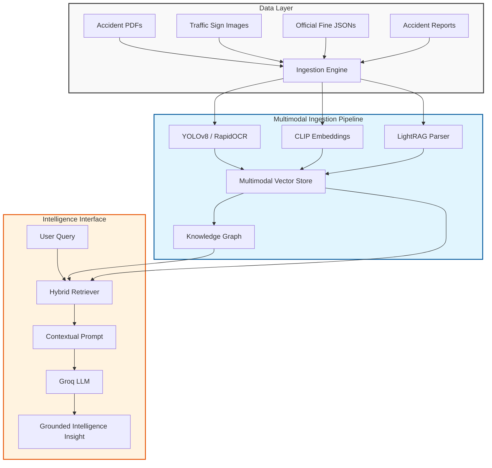

<div align="center">


<a href="https://git.io/typing-svg">
  
</a>

<br/>

[](https://www.python.org/)
[](https://fastapi.tiangolo.com/)
[](https://nextjs.org/)
[](https://groq.com/)
[](https://ultralytics.com/)
[](https://www.typescriptlang.org/)

**A production-grade AI system bridging the gap between raw traffic sensor data, accident reports, and actionable urban intelligence.**

[Explore the Architecture](#-system-architecture) • [Installation Guide](#-installation-and-setup) • [Core Features](#-core-features)

</div>

---

## 📌 Overview

**Lahore Traffic Intelligence AI** is a sophisticated multimodal Retrieval-Augmented Generation (RAG) system designed to analyze, synthesize, and query complex urban traffic datasets. Unlike traditional text-based RAG, this system implements a **Vision-Language pipeline** that integrates Computer Vision (YOLOv8), semantic image embeddings (CLIP), and structured Knowledge Graphs to provide grounded insights into traffic patterns and incident reporting.

The system transforms unstructured data—including accident PDFs, traffic sign imagery, and official penalty schedules—into a searchable, high-fidelity knowledge base.

## ✨ Core Features

### 👁️ Multimodal Perception Pipeline
- **Object Detection**: Integration of **YOLOv8** for high-precision detection of vehicles, motorcycles, and riders.
- **Specialized Vision Modules**: Dedicated detectors for **Helmet Compliance** and **License Plate Localization**.
- **OCR Intelligence**: Integration of **RapidOCR (PP-OCRv4)** for extracting text from license plates and traffic signage.
- **Semantic Image Search**: CLIP-based embeddings allowing users to retrieve visually similar accident evidence via natural language.

### 🧠 Intelligence Engine
- **Hybrid RAG-Anything**: A dual-retrieval strategy combining **Naive Vector Search** (semantic chunks) with **Graph-based Retrieval** (relational entities).
- **Knowledge Graph Integration**: Automatic extraction of entities and relationships, exportable via **GraphML** for structural analysis in tools like Gephi.
- **Groq-Accelerated Inference**: Leveraging LPU technology for ultra-low latency LLM responses, ensuring real-time query performance.
- **Strict Grounding**: A rigorous evidence-boundary system that prevents model hallucination by strictly adhering to sourced accident reports and official regulations.

### 🛠️ Evidence & Legal Pipeline
- **Violation Analysis**: Deterministic rules engine that maps visual detections (e.g., "no helmet") to official Punjab traffic fines.
- **Automated Report Generation**: Synthesis of visual evidence, detected violations, and legal citations into a professional report format.
- **Provenance Tracking**: Every insight is linked back to a specific source ID, page number, or image URL.

---

## 🧱 System Architecture



---

## 🚀 Technology Stack

| Layer | Technology | Purpose |
| :--- | :--- | :--- |
| **Frontend** | `Next.js 16`, `React 19`, `Tailwind CSS 4` | High-performance, motion-enhanced monitoring dashboard |
| **Backend** | `FastAPI`, `Pydantic` | Asynchronous API orchestration and state management |
| **RAG Framework** | `RAG-Anything`, `LightRAG` | Multimodal retrieval and Graph-based knowledge management |
| **LLM Engine** | `Groq` (LPU) | Ultra-fast inference for grounded text generation |
| **Vision** | `YOLOv8`, `ONNX Runtime` | Real-time object detection and violation analysis |
| **OCR** | `RapidOCR` | Text extraction from plates and signage |
| **Embeddings** | `Sentence-Transformers` | Local semantic vectorization (`all-MiniLM-L6-v2`) |
| **Storage** | `SQLite`, `NumPy (.npz)` | Conversation history and image embedding storage |

---

## 🔧 Installation and Setup

### 📋 Prerequisites
- **Python**: $\ge 3.12, < 3.14$
- **Node.js**: $\ge 18.0.0$
- **Hardware**: GPU recommended for YOLOv8 inference (CPU fallback supported via ONNX)

### 🛠️ Backend Setup
```bash
# Navigate to backend
cd backend

# Create and activate virtual environment
python -m venv venv
# Windows:
venv\Scripts\activate
# macOS/Linux:
source venv/bin/activate

# Install dependencies
pip install -r pyproject.toml
```

**Environment Configuration**
Create a `.env` file in the `backend/` directory:
```env
GROQ_API_KEY=your_groq_api_key_here
RAG_ENABLED=True
RAG_QUERY_MODE=hybrid
BACKEND_CORS_ORIGINS=http://localhost:3000
```

### 💻 Frontend Setup
```bash
# Navigate to frontend
cd frontend

# Install dependencies
npm install

# Start development server
npm run dev
```

---

## 📖 Usage Examples

### 1. Incident Intelligence Query
**User**: *"What are the common causes of accidents in the Gulberg area of Lahore?"*  
**System**: Retrieves accident reports from the vector store $\to$ Extracts patterns from the Knowledge Graph $\to$ Synthesizes a response grounded in official reports.

### 2. Visual Evidence Analysis
**User**: (Uploads image of a motorcycle rider)  
**System**: 
1. **Detection**: Identifies `motorcycle` and `person`.
2. **Analysis**: Checks for `helmet` $\to$ Result: `Negative`.
3. **Legal Mapping**: Maps "No Helmet" to `Punjab Traffic Fine Schedule` $\to$ Identifies PKR amount.
4. **Output**: Generates a report with visual crops as evidence.

---

## 📁 Project Directory Structure

```text
Lahore-Traffic-AI/
├── backend/               # FastAPI Core
│   ├── app/
│   │   ├── api/           # REST Endpoints
│   │   ├── core/          # Global Config & Settings
│   │   ├── ingestion/     # Multimodal Data Pipeline
│   │   ├── rag/           # RAG-Anything / LightRAG Engine
│   │   └── services/      # Vision, Evidence, & Database Logic
│   ├── models/            # YOLOv8 & OCR Weights
│   └── rag_storage/       # Vector & Graph Indices
├── frontend/              # Next.js 16 Dashboard
│   ├── app/               # App Router & Pages
│   └── components/        # UI Components (Tailwind/Motion)
├── scripts/               # Data Acquisition & Eval Tools
├── data/                  # Raw & Processed Datasets
└── graphs/                # Exported .graphml Visualizations
```

---

## ⚠️ Technical Limitations & Considerations

<details>
<summary><b>Click to view Model Constraints</b></summary>

- **Temporal Data**: Single images do not establish movement; findings are static and require manual review for behavioral violations.
- **Class Granularity**: The current COCO-based weights do not reliably distinguish between vans and rickshaws.
- **OCR Accuracy**: Plate text is unverified and must be cross-checked against the provided image crop.
- **Context**: Punjab fine amounts are based on the most recently available structured registry; local jurisdictional variations may exist.
</details>

---

## 🤝 Contributing

Contributions to improve the **Vision-RAG** accuracy or expand the **Knowledge Graph** depth are welcome.

1. Fork the Project
2. Create your Feature Branch (`git checkout -b feature/AmazingFeature`)
3. Commit your Changes (`git commit -m 'feat: Add some AmazingFeature'`)
4. Push to the Branch (`git push origin feature/AmazingFeature`)
5. Open a Pull Request

---

## 📄 License

This project is open-source and provided "as-is" for research and public safety enhancement.

<div align="center">

### Built with obsession by **Salik Ahmad** 🤖

<p>
  <a href="https://salikahmad.vercel.app/" target="_blank">
    
  </a>
  <a href="https://www.linkedin.com/in/salik-ahmad-programmer/" target="_blank">
    
  </a>
  <a href="https://github.com/SalikAhmad702" target="_blank">
    
  </a>
</p>

<br/>

<a href="https://salikahmad.vercel.app/">
  
</a>

<br/>


</div>
